# Лабораторная 1

## Используемое окружение

### Control node

| Параметр | Значение |
|---|---|
| Устройство | MacBook Air |
| ОС | macOS 26.6.2 |
| Ansible | ansible-core 2.21.5, установлен через Homebrew |
| Python (control node) | 3.15.2  |

### Managed node

| Параметр | Значение |
|---|---|
| Провайдер | sprintbox.ru, локация Санкт-Петербург |
| Тариф | Мидл+ |
| CPU / RAM / диск | 2 vCPU / 4 ГБ / 50 ГБ NVMe |
| ОС | Ubuntu 24.04 LTS |
| Ядро | 6.8.0-147-generic |
| Python (managed node) | 3.12.3 |
| Подключение | SSH по ключу, пользователь root |

_____________
## Настройка

Покупаю ВМ на sprintbox.ru. Для начала работы устанавливаю Ansible 

```bash
brew install ansible
```

Проверяю установку:

```bash
ansible --version
```

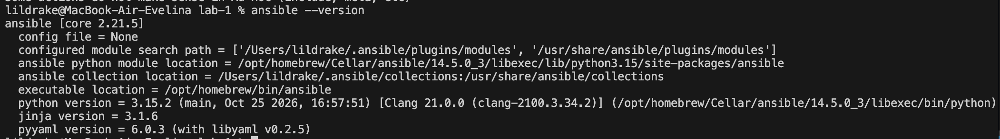

Чтобы проверить связь между `control node` и `managed node`, создаю файл `inventory.ini`, в нем пишу название группы серверов, имя виртуальной машины, IP и имя пользователя.  

```bash
nano inventory.ini
```


Создаю файл `ansible.cfg`, в нем прописываю настройку, чтобы он по дефолту использовал мой файл `inventory.ini`, благодаря этому при запуске работы Ansible можно постоянно не писать `-i`

```bash
nano ansible.cfg
```


Для проверки связи запускаю ad-hoc команду на всех хостах из `inventory.ini` и использую модуль `ping`

```bash
ansible all -m ping
```

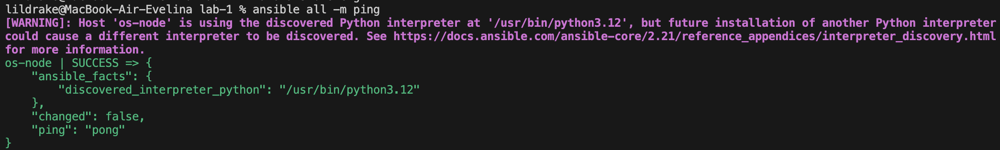

Ответ получен, но чтобы каждый раз мне не вылезал `WARNING` - interpreter discovery, поиск, какой `python` используется на ВМ (fact, полученный от ВМ, сохраняется в памяти Ansible) я добавляю строчку в `ansible.cfg`, которая будет указывать сразу, какая версия `python` будет на ВМ.

```bash
interpreter_python = /usr/bin/python3
```

Отправляю модуль `ping` заново:


___________
## Разбор OpenSearch

Чтобы понять, что мне нужно писать для роли, что требует OpenSearch, какие у него конфиги, где он их хранит, я сначала разобралась в самом сервисе. Логику работы OpenSearch мне помогла понять схемка, которую я нарисовала:

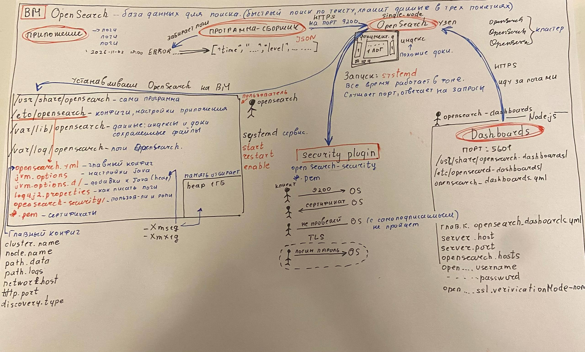


OpenSearch при установке сам создаёт системного пользователя `opensearch`, каталоги программы, конфигурации, данные и логи, а также сервис systemd. Роль будет отвечать за остальное - за подключение репозитория и установку версии, за настройку ядра `vm.max_map_count`, конфигурацию, запуск и проверку готовности.

Главный конфиг `/etc/opensearch/opensearch.yml` будет полностью заменять файл, созданный пакетом. Значения, которые пользователь может захотеть изменить - имя кластера, сетевой адрес и порт, будут вынесены в переменные в `defaults/main.yml`.  single-node будет задан в шаблоне без переменной `discovery.type: single-node`.

Размер heap задаётся отдельным файлом `heap.options` в каталоге `/etc/opensearch/jvm.options.d/`, чтобы не перезаписывать основной `jvm.options`.

При изменении любого из этих файлов задача отправляет `notify` и handler будет перезапускать OpenSearch, чтобы он перечитал конфигурацию.

________
## Ход работы

Создаю скелет роли с помощью команды 

```bash
ansible-galaxy init roles/opensearch
```

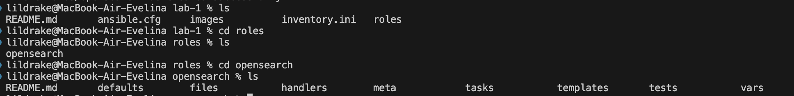

В корне создаю `site.yml`, чтобы настроить роли
```bash
nano site.yml
```

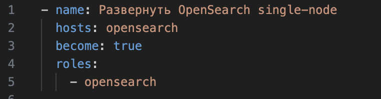

Даю название `play`, указываю, какую группу хостов в `inventory.ini` использовать, даю право выполнять все задачки через `sudo`, пишу, какую роль выполнить - `opensearch`

Так как у `apt` в списке пакетов нет opensearch, его необходимо будет установить. В `vars/main.yml` помещаю три переменные. Первая будет хранить ссылку на репозиторий, откуда скачать ключ, вторая переменная - куда положить ключ на ВМ, третья указывает адрес репозитория, откуда `apt` будет скачивать сами пакеты OpenSearch. В самой инструкции по установке OpenSearch указано, что его можно скачать либо вручную из пакета Debian, либо из репозитория APT. 

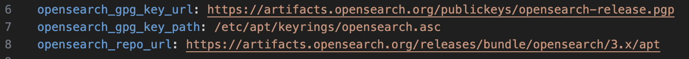

В настройках пользователя `defaults/main.yml` добавляю строчку версии, в директории `defaults` переменные можно изменять, в директории `vars` - нет. 

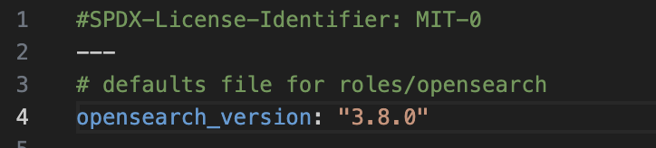

В документации сказано:

>При установке OpenSearch 2.12 и более поздних версий необходимо задать собственный пароль администратора, чтобы настроить демонстрационную конфигурацию безопасности. OpenSearch использует этот пароль только при настройке демонстрационной конфигурации безопасности.
>

Нужен пароль для пользователя `admin` внутри самого OpenSearch, чтобы внутрь могли зайти только те, кому это разрешено.
Создаю директорию `group_vars/all`, в ней создаю зашифрованный файл `vault.yml`, откуда Ansible будет брать переменные. Благодаря этому никто не сможет узнать пароль от OpenSearch, когда Ansible понадобится пароль, я дам ему пароль от vault и он сможет взять пароль от OpenSearch, этот пароль он будет расшифровывать в памяти и в результате на диск ничего не будет записываться. 
> сори за тавтологию

```bash
EDITOR=nano ansible-vault create group_vars/all/vault.yml
```

Проверяю, что файл зашифрован:


Затем все просто, нужно будет описать задачи, которые должна будет выполнить виртуальная машина. Ей необходимо будет создать директорию, в которой она будет хранить ключ для установки OpenSearch, затем она будет скачивать его и подключать репозиторий. После уже можно будет устанавливать программу и запускать.

Я не особо понимаю, как это писать, но зато я понимаю смысл. Поэтому попросила гпт написать код в `tasks/main.yml`

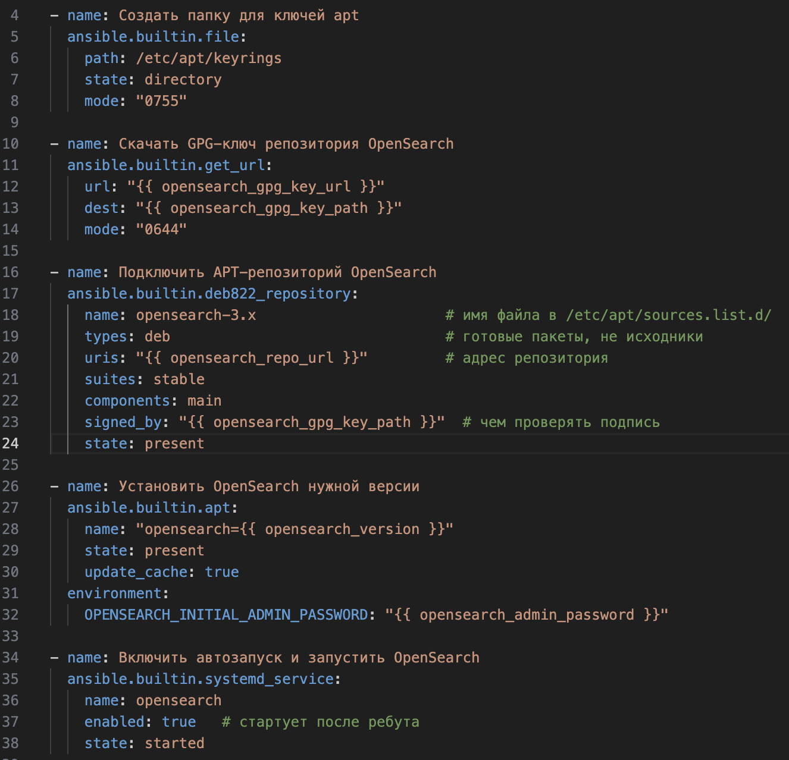

Запускаю установку OpenSearch ролью

```bash
ansible-playbook site.yml --ask-vault-pass
```

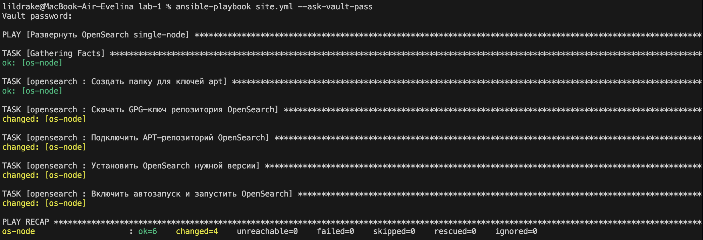

Чтобы добавлять переменные и настраивать opensearch.yml, просматриваю его содержимое

```bash
ansible all -m command -a "cat etc/opensearch/opensearch.yml" --ask-vault-pass
```

Копирую все содержимое и переношу в `templates/opensearch.yml.j2`. Сейчас работают только две переменные - `path.data` и `path.logs`

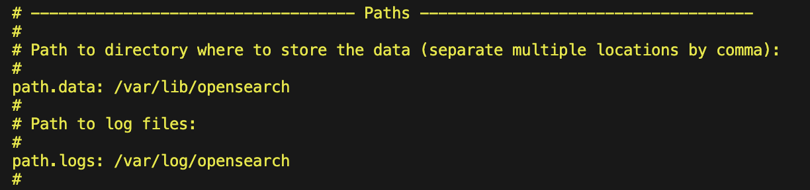

значения переменных изменяться не будет, поэтому добавляю их сожержимое в `vars/main.yml`

```yml
opensearch_path_data: /var/lib/opensearch
opensearch_path_logs: /var/log/opensearch
```

В `templates/opensearch.yml.j2` значения перемнных записываю как 

```jinja
path.data: {{opensearch_path_data}}
path.logs: {{opensearch_path_logs}}
```

У меня сингл-нода, поэтому в `defaults/main.yml` записывваю значения для одного клстера и одной ноды, так как эти переменные могут изменяться

```yml
opensearch_cluster_name: lab_1_opensearch
opensearch_node_name: node_1_opensearch
```

Просмтариваю блок memory. 

`bootstrap.memory_lock` - не выгружать heap в swap

`swap` - место на диске, когда оперативной памяти не хватает, Linux может выгрузить часть памяти программы на диск, чтобы освободить место. Программа при этом продолжает работать, но обращение к выгруженной памяти идёт уже к диску, в результате она будет работать в сотни раз медленнее. Для OpenSearch это плохо, если часть heap окажется на диске, поиск начнёт тормозить

`bootstrap.memory_lock: true` - запрет на выгружение heap на диск

Сначала я хотела раскомментировать `bootstrap.memory_lock`, но гпт сказал, что так делать нельзя, так как у меня итак нету `swap`, из-за чего при запуске opensearch у меня просто выйдет ошибка. Команда для проверки `swap`:

```bash
lildrake@MacBook-Air-Evelina lab-1 % ansible all -m command -a "free -h" --ask-vault-pass
Vault password: 
os-node | CHANGED | rc=0 >>
               total        used        free      shared  buff/cache   available
Mem:           3.8Gi       1.8Gi       193Mi       2.7Mi       2.1Gi       2.0Gi
Swap:             0B          0B          0B
```

Так как `swap` нету, ничего выгружаться на диск не будет.

У задания значения `heap` есть правило - максимум можно взять не больше половины RAM. Так как у меня еще будет Dashboards, я беру `heap = 1 Гб`.

Так как `opensearch.yml` это настройки OpenSearch, а `heap` это настройки, которые читает Java при запуске, создаю файл `templates/heap.options.j2`, он будет читаться перевее `opensearch.yml`, добавляю в него две настройки Java для `heap`

```jinja
-Xms{{ opensearch_heap_size }} 
-Xmx{{ opensearch_heap_size }} 
```

>Порядок запуска: systemd запускает java и передает ей настройки (/etc/opensearch/jvm.options.d/ на ВМ) -> Java запускает внутри себя OpenSearch -> OpenSearch читает opensearch.yml
>

в `defaults/main.yml` добавляю значение

```yml
opensearch_heap_size: "1g"
```

Иду в блок `Network`. `network.host` говорит OpenSearch на каком адресе ВМ слушать, задаю ему значение 127.0.0.1, чтобы он мог принимать запросы только от самой ВМ. Пробрасываю порт со своего ноутбука на ВМ, чтобы было удобнее проверять curl.

```bash
ssh -f -N -L 9200:localhost:9200 root@170.168.151.74
```

Также в `opensearch.yml.j2` открываю порт. Значения переменных записываю в `defaults/main.yml`

```jinja
network.host: {{opensearch_network_host}}
http.port: {{opensearch_http_port}}
```

`Discovery` - нужен, если несколько узлов, добавляю в него строчку, которая будет явно задавать сингл-ноду

```jinja
discovery.type: single-node
```

`Gateway` - нужен, если несколько узлов. Помогает узлам правильно запускаться

`Various` - защита от случайного удаления. `action.destructive_requires_name:` - разрешает удаление только по имени индекса, запрещает удаление по шаблонам `DELETE /logs-*`, `DELETE /_all`. Добавляю эту переменную и отправляю ее значение в `defaults/main.yml`. `lower` - защита от ошибки с `True` или `False`.

```jinja
action.destructive_requires_name: {{ opensearch_action_destructive_requires_name | lower}}
```

`Remote Store` - хранение данных на удаленном хранилище

`Experimental Features` - экспериментальные функции

В плагинах все оставляю как есть, кроме `plugins.security.compliance.salt` - используется, чтобы скрывать значения в журналах безопасности. Изменяю на 

```jinja
plugins.security.compliance.salt: "{{ opensearch_security_salt }}"
```

добавляю значение в vault файл:

```bash
EDITOR=nano ansible-vault edit group_vars/all/vault.yml
```

В документации рекомендуется поднять лимит количества областей отображения памяти (memory map areas) в ядре Linux до 262144 (по умолчанию 65530), которые может создать один процесс. Добавляю для этого задачу перед запуском OpenSearch

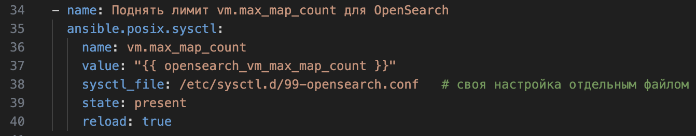

Значение переменной записываю в `/vars/main.yml`

Теперь необходимо сделать задачи, которые положать конфиг `opensearch.yml.j2` в ВМ. Сначала смотрю права файлов на ВМ:

```bash
ansible all -m command -a "ls -l /etc/opensearch" --ask-vault-pass
-rw-r----- 1 opensearch opensearch  6086 Nov  2 23:05 opensearch.yml
drwxr-x--- 2 opensearch opensearch  4096 Oct 14  2022 jvm.options.d
```

Записываю задачи:

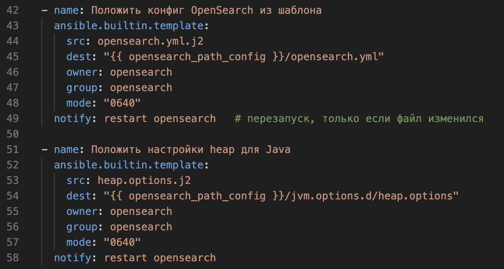

Добавляю переменную в `vars/main.yml`

```yml
opensearch_path_config: /etc/opensearch
```

в `/handlers/main.yml` записываю задачу для перезапуска OpenSearch:

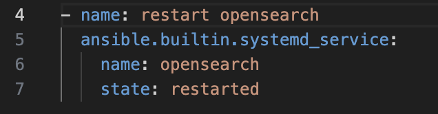

Задача выполнится, только когда от ВМ придет сообщение `change`.

Теперь запускаю плейбук:

```bash
ansible-playbook site.yml --ask-vault-pass
```

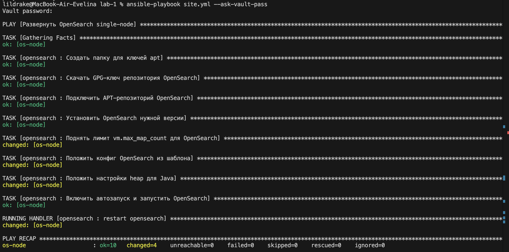

с помощью curl проверяю, кто отвечает:

```bash
curl -k -u 'admin:*************' "https://localhost:9200"
```

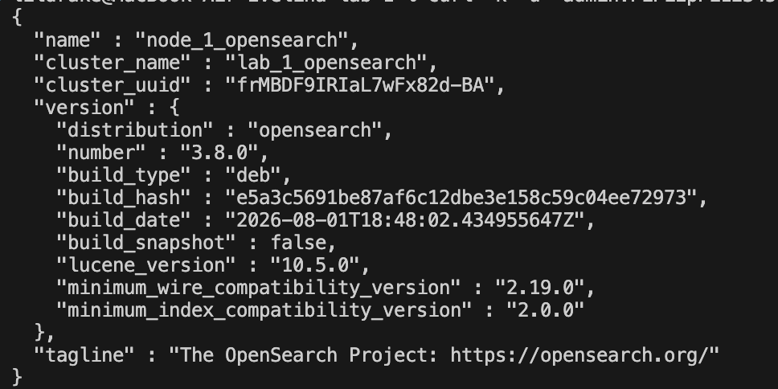

Проверяю здоровью кластера:

```bash
curl -k -u 'admin:**************' "https://localhost:9200/_cluster/health?pretty"
```

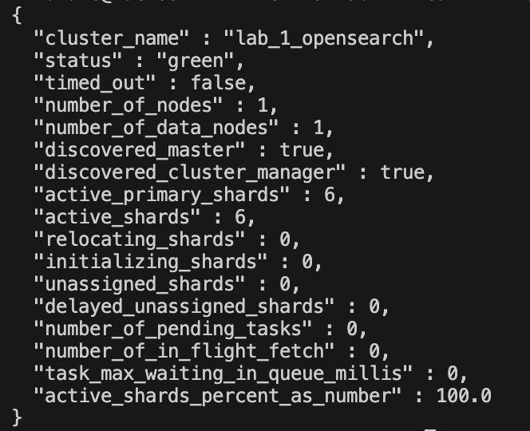

Проверяю работу `heap.options`:

```bash
curl -k -u 'admin:*************' "https://localhost:9200/_cat/nodes?v&h=name,heap.max"
name              heap.max
node_1_opensearch      1gb
```

Добавляю задачи для проверки готовности через API. Хендлеры по умолчанию ждут конца play. Но тогда наша проверка спросит OpenSearch до перезапуска, то есть проверит старый процесс со старым конфигом. `flush_handlers` говорит выполнииь хендлеры из очереди прямо сейчас. Если флажков нет, то он ничего не делает.

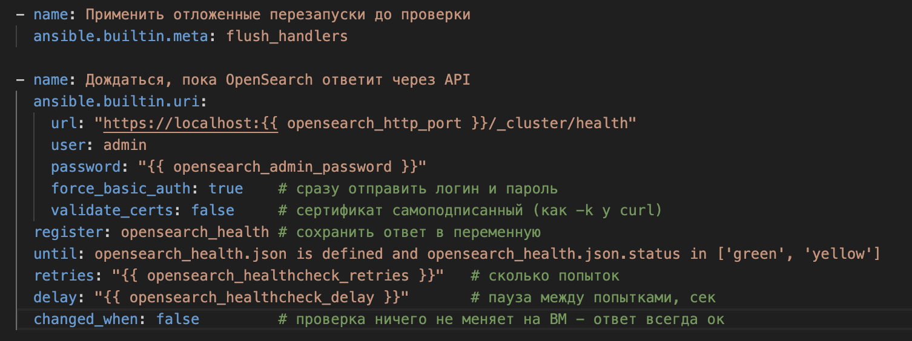

В файл `defaults/main.yml` добавляю две переменные:

```yml
opensearch_healthcheck_retries: 30
opensearch_healthcheck_delay: 10
```

Запускаю плейбук:

```bash
ansible-playbook site.yml --ask-vault-pass
```

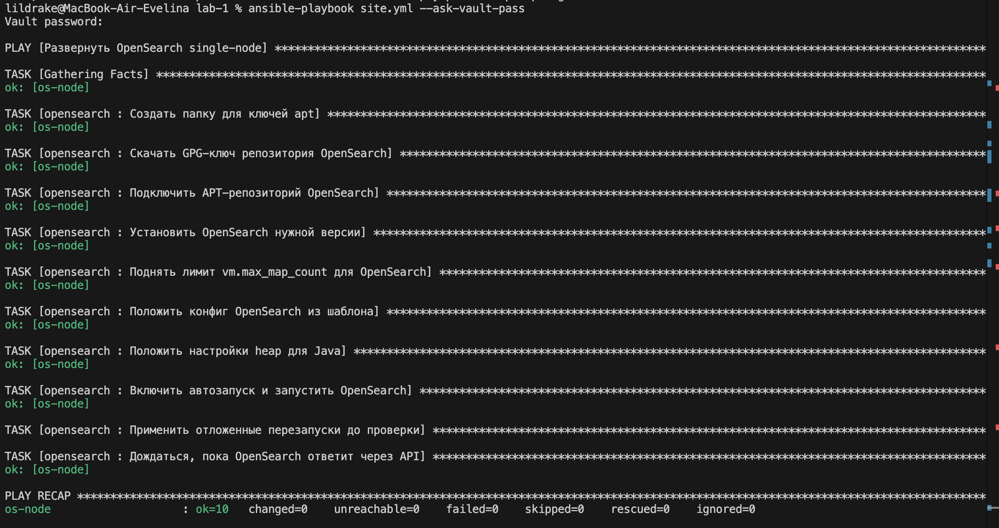

_____
### OpenSearch Dashboards

Создаю задачу по установке Dashboards. Первая задача - установка APT-репозитория, вторая - установка Dashboards нужной версии, третья - включение автозапуска и запуска Dashboards

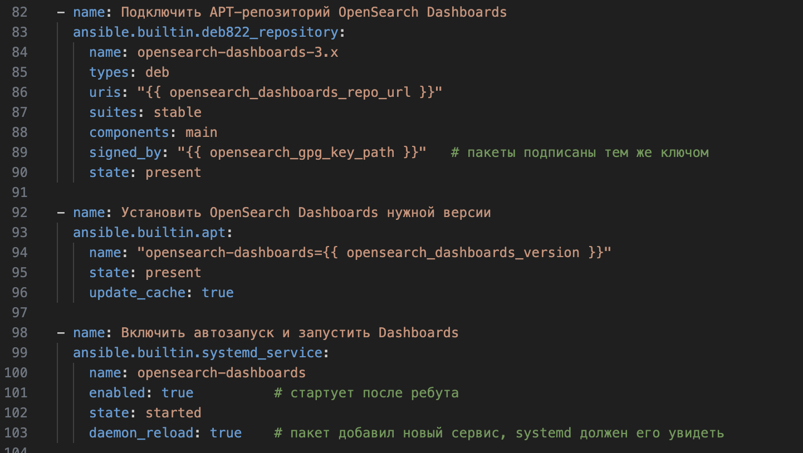

в `vars/main.yml` добавляю две переменные

```yml 
opensearch_dashboards_repo_url: https://artifacts.opensearch.org/releases/bundle/opensearch-dashboards/3.x/apt
opensearch_dashboards_version: "{{ opensearch_version }}" 
```

Запускаю плейбук, смотрю конфиг `opensearch-dashboards.yml` и права

```bash
ansible-playbook site.yml --ask-vault-pass
ansible all -m command -a "cat /etc/opensearch-dashboards/opensearch-dashboards.yml" --ask-vault-pass
ansible all -m command -a "ls -l /etc/opensearch-dashboards" --ask-vault-pass
```

После запуска он мне ывыдал ошибку 

```bash
TASK [opensearch : Установить OpenSearch Dashboards нужной версии] **********************************************************************************
[ERROR]: Task failed: Failed to connect to the host via ssh: Shared connection to 170.168.151.74 closed.
Origin: /Users/lildrake/INFRA/lab-1/roles/opensearch/tasks/main.yml:92:3

90     state: present
91
92 - name: Установить OpenSearch Dashboards нужной версии
     ^ column 3

fatal: [os-node]: UNREACHABLE! => {"changed": false, "msg": "Task failed: Failed to connect to the host via ssh: Shared connection to 170.168.151.74 closed.", "unreachable": true}

PLAY RECAP ******************************************************************************************************************************************
os-node                    : ok=11   changed=1    unreachable=1    failed=0    skipped=0    rescued=0    ignored=0   
```

Отправляю ping для проверки доступа к opensearch

```bash
ansible all -m ping --ask-vault-pass
Vault password: 
[ERROR]: Task failed: Failed to connect to the host via ssh: Connection timed out during banner exchange
Connection to 170.168.151.74 port 22 timed out
Origin: <adhoc 'ping' task>

{'action': 'ping', 'args': {}, 'timeout': 0, 'async_val': 0, 'poll': 15}

os-node | UNREACHABLE! => {
    "changed": false,
    "msg": "Task failed: Failed to connect to the host via ssh: Connection timed out during banner exchange\r\nConnection to 170.168.151.74 port 22 timed out",
    "unreachable": true
```

Чтобы исключить проблему с памятью, пишу код который будет показывать не убил ли Linux процессы

```bash
ansible all -m shell -a "journalctl -k --since '-30 min' | grep -i -E 'out of memory|killed process'" --ask-vault-pass
Vault password: 
[ERROR]: Task failed: Module failed: The command exited with a non-zero return code.
Origin: <adhoc 'shell' task>

{'action': 'shell', 'args': {'_raw_params': "journalctl -k --since '-30 min' | grep -i -E 'out of memory|killed [...]

os-node | FAILED | rc=1 >>
The command exited with a non-zero return code.
```

Походу ansible просто не дождался ответа от ВМ? Тип если очень долго загружался дашбордс? 

Запускаю плейбук еще раз, на этот раз все получилось. Проверяю файлы и права на них:

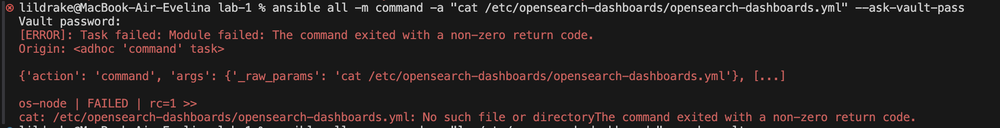

чооооооо блин

Проверяю существует ли вообще директория `opensearch-dashboards`:

```bash
ansible all -m command -a "ls /etc/opensearch-dashboards" --ask-vault-pass                          
Vault password: 
os-node | CHANGED | rc=0 >>
node.options
opensearch_dashboards.yml
```

Все пон, моя ошибка была в том, что вместо нижнего подчеркивания я писала дефис. Команда для просмотра конфига:

```bash
ansible all -m command -a "cat /etc/opensearch-dashboards/opensearch_dashboards.yml" --ask-vault-pass
```

теперь все работает, полностью копирую конфиг себе в `templates/opensearch_dashboards.yml.j2`, добавляю переменные в `defaults/main.yml`:

```yml
opensearch_dashboards_server_host: "127.0.0.1"   
opensearch_dashboards_server_port: 5601
opensearch_dashboards_server_name: lab_1_opensearch_dashboards
opensearch_dashboards_username: kibanaserver   
```

Добавляю задачу для добавления `opensearch_dashboards.yml.j2` на ВМ

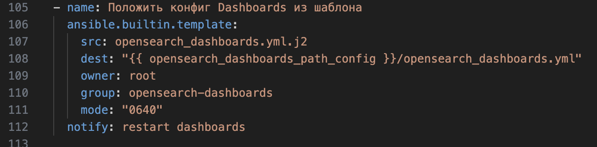

Добавляю переменную в `vars/main.yml` 

```yml
opensearch_dashboards_path_config: /etc/opensearch-dashboards
```

Также добавляю хендлер для перезапуска opensearch-dashboards после изменений

```yml
- name: restart dashboards
  ansible.builtin.systemd_service:
    name: opensearch-dashboards  
    state: restarted
```

Так как dashboards тоже слушает только 127.0.0.1 добавляю туннель с моего ноута

```bash
ssh -f -N -L 5601:localhost:5601 root@170.168.151.74
```

Запускаю плейбук

```bash
TASK [opensearch : Положить конфиг Dashboards из шаблона] *******************************************************************************************
changed: [os-node]

RUNNING HANDLER [opensearch : restart dashboards] ***************************************************************************************************
changed: [os-node]

PLAY RECAP ******************************************************************************************************************************************
os-node                    : ok=15   changed=2    unreachable=0    failed=0    skipped=0    rescued=0    ignored=0 
```

В браузере открываю `http://localhost:5601`, вхожу под пользователем с Гайдуляном: 

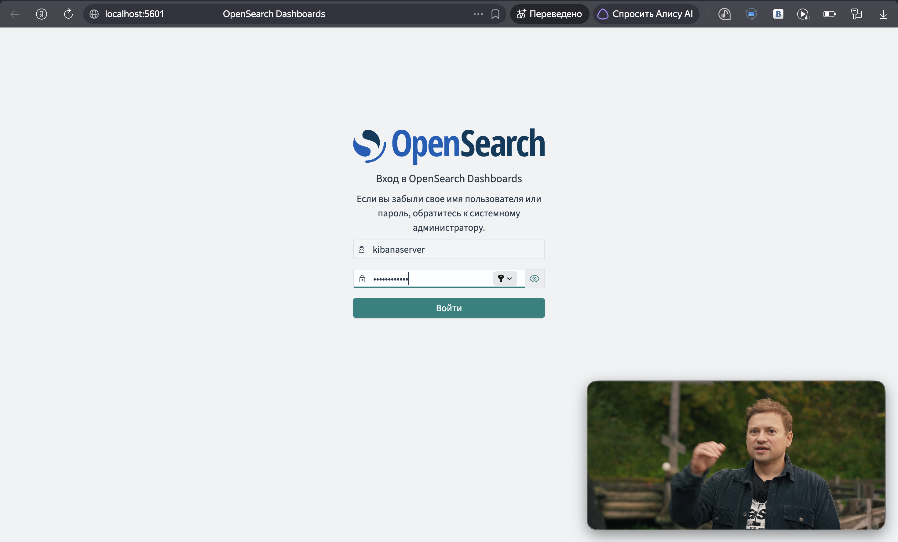

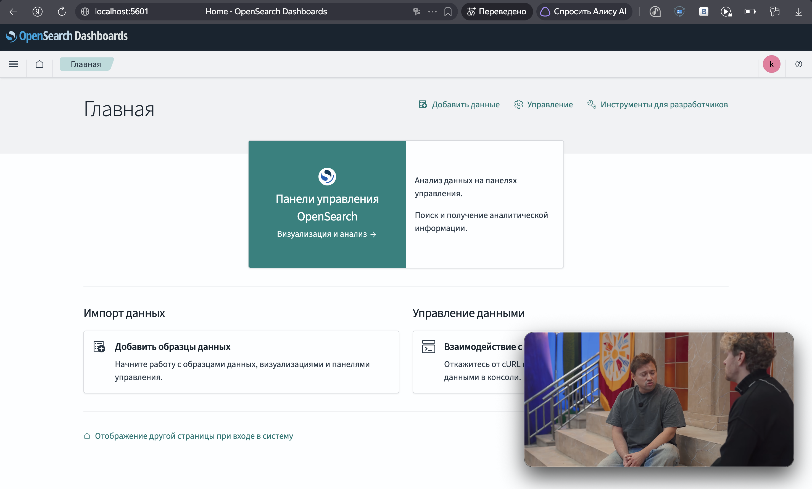

Теперь буду проверять, что OpenSearch и Dashboards поднимаются сами, без Ansible и без нас. Для этого перезагружаю ВМ. 

```bash
ansible all -m reboot --ask-vault-pass
os-node | CHANGED => {
    "changed": true,
    "elapsed": 51,
    "rebooted": true
}
```

Проверяю, что серверы поднялись сами 

```bash
ansible all -m command -a "systemctl is-active opensearch opensearch-dashboards" --ask-vault-pass
os-node | CHANGED | rc=0 >>
activating
active
```

Заново пробрасываю порты и проверяю здоровье OpenSearch с помощью curl

```bash
curl -k -u 'admin:***************' "https://localhost:9200/_cluster/health?pretty"
curl: (35) Recv failure: Connection reset by peer
```

пипец. Опять использую команду для проверки статуса OpenSearch:

```bash
ansible all -m command -a "systemctl is-active opensearch opensearch-dashboards" --ask-vault-pass
Vault password: 
os-node | CHANGED | rc=0 >>
failed
active
```

Теперь он не запускается, хотя в прошлый раз писал `activating`. Смотрю журнал OpenSearch

```bash
ansible all -m command -a "journalctl -u opensearch -b --no-pager -n 40" --ask-vault-pass
Nov 03 23:09:08 box-988137 systemd[1]: opensearch.service: start operation timed out. Terminating.
Nov 03 23:09:08 box-988137 systemd[1]: opensearch.service: Failed with result 'timeout'.
Nov 03 23:09:08 box-988137 systemd[1]: Failed to start opensearch.service - OpenSearch.
Nov 03 23:09:08 box-988137 systemd[1]: opensearch.service: Consumed 33.994s CPU time.
```

Ошибка таймаут, systemd начал запускать OpenSearch и не получил от него ответ за 76 секунд, из-за этого он прервал запуск и убил процесс. 

Чтобы это исправить нужно просто добавить больше времени ожидания. Лимит хранится в настройках systemd, значит задача должна стоять до запуска OpenSearch. В systemd есть drop-in файлы - маленькие файлы-дополнения в папке /etc/systemd/system/opensearch.service.d/. systemd читает основной файл сервиса, а потом поверх него эти дополнения. Пакет их не трогает. Поэтому для изменения значения использую директорию `/files`, так как она не будет содержать переменные и значения никак изменять не нужно, будет использоваться можуль copy.

Создаю файл `opensearch-timeout.conf` и добавляю в него знаечние:

```conf
[Service]
TimeoutStartSec=180
```

Добавляю задачи

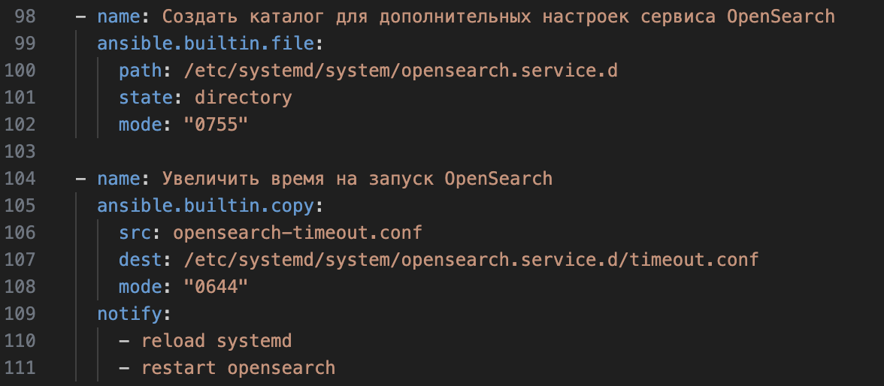

Добавляю хендлер

```yml
- name: reload systemd
  ansible.builtin.systemd_service:
    daemon_reload: true  
```

Запускаю роль 

```bash
ansible-playbook site.yml --ask-vault-pass
RUNNING HANDLER [opensearch : restart opensearch] ***************************************************************************************************
changed: [os-node]

PLAY RECAP ******************************************************************************************************************************************
os-node                    : ok=18   changed=4    unreachable=0    failed=0    skipped=0    rescued=0    ignored=0 
```

Теперь заново перезапускаю ВМ, жду 180 секунд и отправляю проверку здоровья

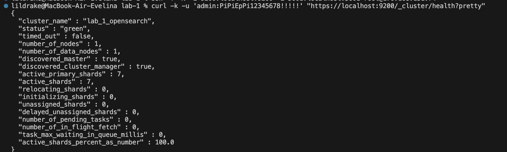

ееееее

Заполняю файл `meta/main.yml`

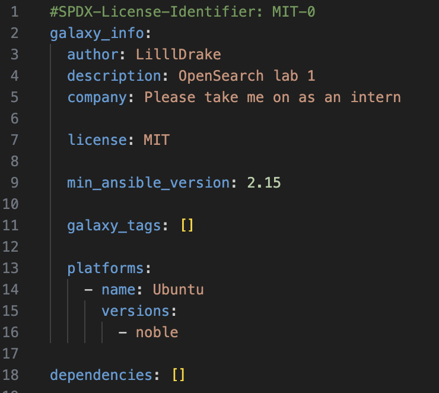

Затем заполняю файл `tests/inventory` (tests - проверяет роль отдельно от проекта)

```bash
#SPDX-License-Identifier: MIT-0
[opensearch]
os-node ansible_host=170.168.151.74 ansible_user=root
```

Я попросила гпт просто написать мне файлик, он мне написал код с двумя плеями и одной задачкой, код будет применять и проверять роль, сработала ли она

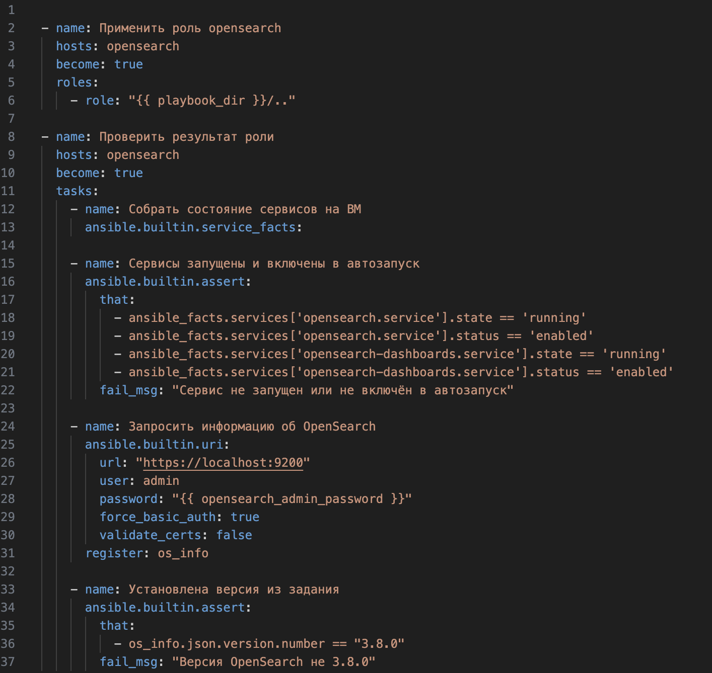

Запускаю ansible-playbook, используя inventory теста, а не проекта, подгружаю переменные

```bash
ansible-playbook -i roles/opensearch/tests/inventory roles/opensearch/tests/test.yml \
  -e @group_vars/all/vault.yml --ask-vault-pass
```

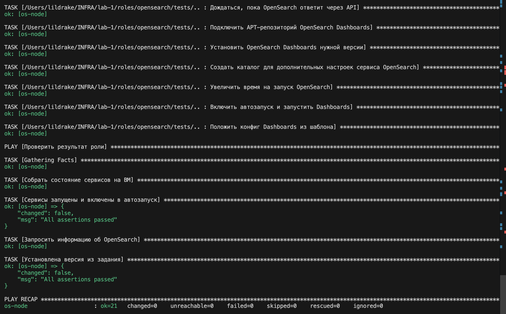

Все проверки прошли, роль идемпотентна. Только сейчас я заметила, что у меня не в том месте находятся две задачи по увеличению времени ожидания systemd, поэтому я переношу их до включения OpenSearch. 

______________

## Вывод

Ну я фулл разобралась в работе OpenSearch и Ansible, я понимала все процессы, какие файлы надо использовать, как подставлять переменные и в какой конкретно файл их писать. Только у меня пока не получается самостоятельно пистать задачки, постоянно ошибаюсь или что-то пропускаю, поэтому большую часть из задачек для меня писал гпт. Чтоб вникнуть я даж нарисовала схему работы Ansible 


вооооот